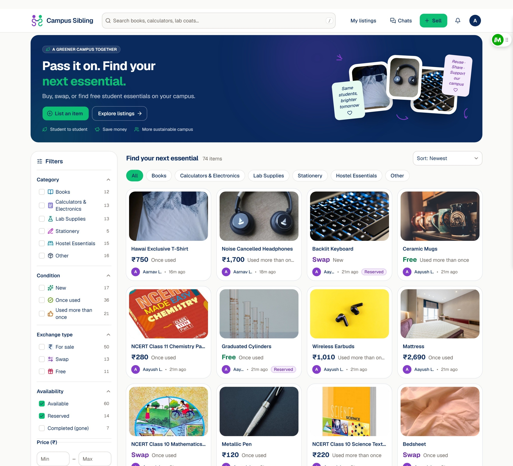
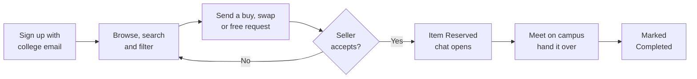

# 🎓 Campus Sibling

**Your senior's old textbook is still in their hostel room. Go get it.**

 

[**Live Demo**](https://campussibling-wnfeccgs.onslate.in) · [**Video**](#-see-it-in-action) · [**Docs**](HANDBOOK.md) · [**Report Bug**](https://github.com/lathi-aayush/Mr-Whose-the-Tech/issues/new?labels=bug) · [**Request Feature**](https://github.com/lathi-aayush/Mr-Whose-the-Tech/issues/new?labels=enhancement)

 

---

## 💡 Why This Exists

Every semester, seniors **throw away or hoard** the textbooks, calculators and lab coats that juniors walk into a shop and **buy new** a week later. The only "marketplace" is a WhatsApp group where a listing sinks in an hour, nobody can search, and "is this still available?" never gets an answer.

**Campus Sibling is one searchable board for one campus**, where every item says exactly where it stands. Stuff gets reused, juniors save money, and less ends up in the bin.

## ⚙️ How It Works

- **Only your campus gets in.** Sign-up needs a college email, so everyone on the board is a fellow student.
- **Every item has a status.** Available, Reserved or Completed. No more chasing sold items.
- **Sell, swap or give away.** Name a price, offer a trade, or just pass it on for free.
- **Your contact stays private** until you accept someone. You choose whether they see your email or phone.
- **Chat opens the moment you say yes**, and an email nudges the other person if they're away.

## 🧭 App Flow

**Sign up with your college email → Browse or search → Send a request → Seller accepts → Chat and meet up → Marked completed**

Selling is the same journey from the other side: **list an item with photos → get a request (and an email) → accept the one you like → chat → mark it done.**

## ✨ What You Can Do With It

- **Find it in seconds** — Search and filter by category, condition, price and type. Share the exact results with a link.
- **List in under a minute** — Snap up to 5 photos from your phone; they're compressed before upload so it stays fast on hostel Wi-Fi.
- **Buy, swap or grab freebies** — Pay cash, trade your old item (with photos of it), or claim something a senior is giving away.
- **Never chase a sold item** — Accepting one request reserves the item and politely declines the rest.
- **Keep your number to yourself** — Contact details appear only after you accept, and only the one you chose.
- **Talk without leaving the app** — Built-in chat with unread counts and a "Seen" mark.
- **Don't miss a deal** — In-app bell, toasts, and emails when you get a request, get accepted, or get a message while you're away.
- **Install it like an app** — Add it to your home screen; it works like a native app on any phone.

## 🙋 Why You Should Be Using It

- **The first-year** who needs a scientific calculator and a drafter by Monday and doesn't want to pay full price.
- **The final-year student** moving out with a shelf of books, a cooler and a kettle, and two days to clear the room.
- **The student on a budget** who'd happily swap a spare lab coat for a used textbook.
- **The campus green club** that wants fewer working items in the trash every semester.

| Without Campus Sibling | With Campus Sibling |
|---|---|
| Listing buried in a group chat within an hour | Searchable board that stays put |
| "Still available?" and silence | Clear Available / Reserved / Completed status |
| Phone number posted to 500 strangers | Contact shared only with the person you accept |
| Anyone can join and spam | College email required |
| Usable stuff thrown out at semester end | Passed on to the next batch |

## 🎬 See It in Action

- **Live app:** https://campussibling-wnfeccgs.onslate.in
- **Demo video (3–5 min):** _link coming soon_

> **For judges:** the app normally accepts only `@vit.edu` emails. Sign-up is open to any email for judging so you can try it.

## 🧱 Tech Stack and Why We Chose It

| Layer | Tech | Why |
|---|---|---|
| Frontend | React 19, Vite, Tailwind CSS 4, shadcn/ui | Fast to build, consistent accessible components, small bundle on mobile data. |
| Hosting | Zoho Catalyst Slate | Static hosting in the same project as the API, so no CORS or extra accounts. |
| API | Catalyst Advanced I/O Function (Node.js 20) | Serverless: nothing to keep running, scales to zero between uses. |
| Database | Catalyst Data Store (ZCQL) | Relational tables for listings, requests and messages with server-enforced status rules. |
| Images | Catalyst Stratus | Photos upload straight from the phone via pre-signed URLs, so the API never handles large files. |
| Auth | Catalyst Embedded Authentication | Email sign-up with a domain check, no password storage on our side. |
| Email | Catalyst Mail | Request, accepted and new-message alerts from the same platform. |

One platform covers hosting, auth, database, storage and mail on a free tier, in an Indian data centre close to the users.

## 🛠️ Setup

For setup instructions, see [setup.md](setup.md).

## 👥 Team

- **Aayush Lathi**

---

## License

Released under the MIT License.

Contributions welcome: open an [issue](https://github.com/lathi-aayush/Mr-Whose-the-Tech/issues) or a pull request.

[GitHub](https://github.com/lathi-aayush) · [Email](mailto:work@lathiaayush.com)

