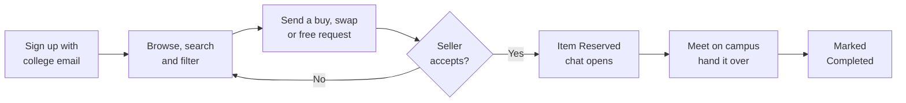

# 🎓 Campus Sibling

**Your senior's old textbook is still in their hostel room. Go get it.**

 

[**Live Demo**](https://campussibling-wnfeccgs.onslate.in) · [**Video**](https://youtu.be/cxaMaHkJT9c) · [**Docs**](HANDBOOK.md) · [**Report Bug**](https://github.com/lathi-aayush/Mr-Whose-the-Tech/issues/new?labels=bug) · [**Request Feature**](https://github.com/lathi-aayush/Mr-Whose-the-Tech/issues/new?labels=enhancement)

 

---

## 🔎 Campus Sibling in Brief

| Area | Details |
|---|---|
| **The problem and the fix** | Seniors throw away usable books and gear while juniors buy the same things new, and WhatsApp groups bury listings within hours. Campus Sibling is one searchable board for one campus, with a clear status on every item, sale, swap or free options, and contact details shared only after the seller accepts. See [Why This Exists](#-why-this-exists). |
| **What works today** | The full loop works in production: sign up, list, search, request, accept, chat, complete. Status changes, request limits and contact privacy are enforced by the API, not just hidden in the UI. Business rules sit in one module covered by 18 unit tests. See the [full feature list](#-full-feature-list). |
| **Why this stack** | Every layer and the reason for it is in the [table below](#-tech-stack-and-why-we-chose-it). |
| **Design and usability** | Built on shadcn/ui components, with layouts for phone and desktop (filters move to a bottom sheet on phones). Skeleton loaders match the final layout, failed loads show a retry button, icon buttons have tooltips that work on hover and keyboard focus, and the app can be installed to a home screen. |
| **Where it runs** | Live at [campussibling-wnfeccgs.onslate.in](https://campussibling-wnfeccgs.onslate.in). The frontend runs on Catalyst Slate and the API on a Catalyst serverless function, both on the free tier. Polling slows down when a chat is quiet and stops when the tab is hidden, which keeps usage inside the free quotas. |
| **How the code is organised** | `client/` holds pages, shared components and API helpers. `functions/api/` holds the routes (`index.js`), business rules (`lib/rules.js`) and data access (`lib/store.js`), with tests in `test/`. Setup is in [setup.md](setup.md), behaviour and limits in [HANDBOOK.md](HANDBOOK.md). Secrets are gitignored. |
| **See it working** | 3–5 minute walkthrough: [see it in action](#-see-it-in-action). |

## 🧱 Tech Stack and Why We Chose It

| Layer | Tech | Why |
|---|---|---|
| Frontend | React 19, Vite | Component model suits the many shared cards and dialogs. Vite gives fast rebuilds and a small production bundle for phones on mobile data. |
| Routing | React Router 7 | Filters and the open chat live in the URL, so links are shareable and the back button works. |
| UI | Tailwind CSS 4, shadcn/ui (Radix) | Radix handles focus, keyboard and screen-reader behaviour for dialogs, menus and tooltips. Tailwind tokens keep spacing and colour consistent. |
| UI extras | lucide-react, sonner, vaul | Icons, toast alerts, and the bottom sheet used for filters on phones. |
| Hosting | Catalyst Slate | Static hosting in the same Catalyst project as the API, so there is no second provider or CORS setup. |
| API | Catalyst Advanced I/O Function (Node.js 20) | Serverless, so there is no server to keep running and it costs nothing when idle. |
| Database | Catalyst Data Store (ZCQL) | Relational tables for listings, requests and messages, which is what the status rules need. |
| Images | Catalyst Stratus | Photos upload straight from the browser through pre-signed URLs, so the function never handles large files. |
| Auth | Catalyst Embedded Authentication | Sign-up, email verification and password reset come built in. The API adds the campus email domain check. |
| Email | Nodemailer over SMTP, Catalyst Mail fallback | SMTP sends from an existing mailbox without the 100-a-month cap and domain verification Catalyst Mail needs. |
| Testing and lint | `node:test`, oxlint | The built-in test runner needs no extra dependency, and oxlint runs fast enough to use on every change. |

Catalyst covers hosting, auth, database, storage and mail on one free tier, in an Indian data centre close to the users.

## 💡 Why This Exists

Every semester, seniors **throw away or hoard** the textbooks, calculators and lab coats that juniors walk into a shop and **buy new** a week later. The only "marketplace" is a WhatsApp group where a listing sinks in an hour, nobody can search, and "is this still available?" never gets an answer.

**Campus Sibling is one searchable board for one campus**, where every item says exactly where it stands. Stuff gets reused, juniors save money, and less ends up in the bin.

## ⚙️ How It Works

- **Only your campus gets in.** Sign-up needs a college email, so everyone on the board is a fellow student.
- **Every item has a status.** Available, Reserved or Completed. No more chasing sold items.
- **Sell, swap or give away.** Name a price, offer a trade, or just pass it on for free.
- **Your contact stays private** until you accept someone. You choose whether they see your email or phone.
- **Chat opens the moment you say yes**, and an email nudges the other person if they're away.

## 🧭 App Flow

**Sign up with your college email → Browse or search → Send a request → Seller accepts → Chat and meet up → Marked completed**

Selling works the same way from the other side: **list an item with photos → get a request (and an email) → accept the one you like → chat → mark it done.**

## ✨ What You Can Do With It

Each feature starts from a problem students already have with group-chat selling.

**🔍 Search instead of scrolling**
- **The problem:** the calculator you need was posted three days ago, 400 messages up.
- **What changes:** search by text, then filter by category, condition, price and type. The filters live in the URL, so you can send a friend the exact results.
- **Ask yourself:** how many things did you buy new last semester because you couldn't find a used one in time?

**📸 List an item from your phone**
- **The problem:** a listing is a blurry photo and "DM for price".
- **What changes:** add up to 5 photos, a category, a condition and a price. Photos are compressed in the browser before upload, so slow hostel Wi-Fi is enough.
- **Ask yourself:** what's sitting under your bed that a junior would use this week?

**🔄 Sell, swap or give it away**
- **The problem:** not everything is worth haggling over, and some students would rather trade than pay.
- **What changes:** every listing is marked for sale, swap or free. A swap request includes the item being offered, with up to 3 photos of it.
- **Ask yourself:** would you trade your old drafter for the textbook you need next term?

**✅ Know what's still available**
- **The problem:** "is this still available?" gets no reply, or a reply a day later saying it's gone.
- **What changes:** every item shows Available, Reserved or Completed. When the seller accepts one request, the item becomes Reserved and the other pending requests are declined automatically, so nobody waits on a dead listing.
- **Ask yourself:** how many messages would that save you during the move-out week?

**🔒 Share your number only with the buyer**
- **The problem:** posting to a group chat puts your phone number in front of everyone in it.
- **What changes:** contact details stay hidden until the seller accepts a request. The seller picks whether the buyer sees their email or their phone number.
- **Ask yourself:** who has your number right now because you once sold them a kettle?

**💬 Chat and get notified**
- **The problem:** the deal stalls because someone missed a message.
- **What changes:** accepting a request opens a chat with unread counts and a "Seen" mark. A bell and pop-ups cover activity while you're in the app. Email covers new requests, accepted requests, and chat messages you haven't read in 5 minutes.
- **Ask yourself:** how often does a deal fall through just because a reply came late?

**📱 Keep it on your home screen**
- **The problem:** one more app to download is one more reason not to bother.
- **What changes:** add the site to your home screen from the browser and it opens like an app. Press `/` on a keyboard to jump to search.

## 📋 Full Feature List

**Accounts and authentication**
- Sign up with first name, optional last name and email. A verification link arrives by email to set the password.
- Campus-only sign-up: the API rejects emails outside the allowed domain (`@vit.edu` in production, any email for the demo).
- Forgot password: request a reset link by email from the sign-in form.
- Sign-in and sign-out from the account menu. Sell, My listings, Chats and Profile redirect to sign-in and return you afterwards.
- Profile page to edit your name and an optional phone number. Email is read-only because it proves you are on campus.

**Browse and search**
- Text search across title, description and category. Press `/` anywhere to jump to it.
- Filters for category, condition, exchange type (sale, swap, free), availability and price range, each showing how many items match.
- Sort by newest, oldest, or price either way.
- Every filter is stored in the URL, so a copied link shows the same results.
- Completed items are hidden by default. Swap items are hidden while a price range is set.
- On phones, filters open in a bottom sheet.

**Listing an item**
- 1 to 5 photos (JPEG, PNG or WebP, up to 5 MB each), compressed in the browser before upload. The first photo is the cover.
- Title, category, condition (New, Once used, Used more than once), optional description and exchange type.
- Price required only for items for sale, from ₹1 to ₹1,00,000.
- Each condition and exchange type shows a one-line explanation when chosen.

**Listing page**
- Photo gallery with swipe on phones and thumbnails on desktop. Listings without photos get a tinted placeholder for their category.
- Details card with colour-coded icons for condition, exchange type, category and age.
- Seller card, safety tips for meeting on campus, and links to similar items when the item is no longer available.
- Owner controls: mark completed, mark available again, or jump to the item's requests.

**Requests and swaps**
- Send a request to buy, swap or take for free, with a message of up to 500 characters.
- Swap requests name the item being offered and can include up to 3 photos of it.
- You cannot request your own item, request an item that is not available, or send two pending requests for the same item.

**Accepting requests and item status**
- The seller accepts or declines each request. Declining closes it without an email.
- On accept, the seller chooses whether the buyer sees their email or a phone number.
- Accepting reserves the item, declines every other pending request on it, and opens the chat.
- Status moves Available → Reserved → Completed. Reserved can only be reached by accepting a request, and a reserved item can go back to Available if the deal falls through, which closes the chat.
- All of these rules are checked on the server.

**Chat**
- One Chats page lists requests you sent (Buying) and received (Selling), grouped Accepted, Pending and Declined, with search.
- Rows show the last message, time, unread count and a "New" mark.
- Chat opens only for accepted requests, with the item and the contact the seller shared pinned at the top.
- Messages up to 1,000 characters, day dividers, a "Seen" mark, Enter to send and Shift+Enter for a new line.
- Report user: pick a reason, and the admin receives an email with the last 10 messages. Reporting closes the chat for both people.

**Notifications**
- Bell menu with new requests, unopened acceptances and unread messages.
- Unread count on the Chats link and in the browser tab title.
- Toast pop-ups with an Open button when something new arrives while you browse.
- Emails for a new request (to the seller), an accepted request (to the buyer, with the shared contact) and new chat messages.
- Chat emails go out only if you have no unread messages in that chat and have not opened it in the last 5 minutes, so a burst of messages sends one email.

**Polish and accessibility**
- Skeleton loaders that match the final layout on every list and page.
- Error states with a retry button in place of the content.
- Tooltips on icon buttons, status chips and badges, shown on hover and keyboard focus and closed with Escape.
- Installable to a phone home screen through a web app manifest.
- Polling slows down in quiet chats and pauses when the tab is hidden or idle for 5 minutes.

## 🙋 Why You Should Be Using It

- **The first-year** who needs a scientific calculator and a drafter by Monday and doesn't want to pay full price.
- **The final-year student** moving out with a shelf of books, a cooler and a kettle, and two days to clear the room.
- **The student on a budget** who'd happily swap a spare lab coat for a used textbook.
- **The campus green club** that wants fewer working items in the trash every semester.

## 🎬 See It in Action

- **Live app:** https://campussibling-wnfeccgs.onslate.in
- **Demo video (3–5 min):** _link coming soon_

> **Try it yourself:** the app normally accepts only `@vit.edu` emails. Sign-up is open to any email for now, so anyone can test it.

## 🛠️ Setup

For setup instructions, see [setup.md](setup.md).

## 👥 Team

- **Aayush Lathi**

---

## License

Released under the MIT License.

Contributions welcome: open an [issue](https://github.com/lathi-aayush/Mr-Whose-the-Tech/issues) or a pull request.

[GitHub](https://github.com/lathi-aayush) · [Email](mailto:work@lathiaayush.com)

